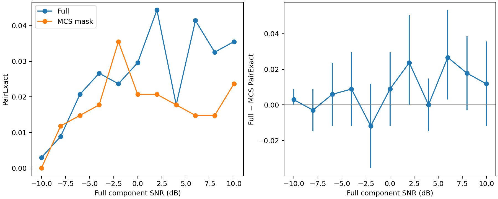

# 双信号 Full80 / MCS-mask80 单种子开发对照与子带对相关性

日期：2026-11-01。**证据等级：单种子、小规模 Development 探索；不能作为正式性能结论。**本轮只比较历史 Coset `[16,11,1,0,27,24,37,31]`，未读取 Final Test、未搜新 Coset、未运行方案 B/PairDrop/KD/C4，也未生成正式 47,840 源数据集。

## 1. 阶段一回顾与执行前复核

单信号 Full80/MCS-mask80 的三个种子和 Validation 选点已由此前报告核实；+10 dB 的 PSK8/PSK16、QAM64/QAM256 类别边界随种子波动，因而本轮不重训单信号。服务器既有双信号 `winner/development_dual` 为 16,900/3,380/3,380 源，旧 QA PASS，但仅保存 16 通道 MCS 输入，缺同源逐视图 Full 和完整槽身份，不能直接构成严格的 Full80/MCS-mask80 配对。旧 16 通道双调制 checkpoint 不能与 Full80 合法横比。

使用冻结 v2 正式候选生成器在独立目录生成**开发用途**双信号 train/Validation/Development 1690/338/338 源；每源 11 档 −10 至 +10 dB，步长 2。两路单位功率、不同随机占用槽，Full 域仅加一次噪声，再从同一 noisy Full 抽取历史 Coset。源和噪声 seed 在三 split 互不重叠；抽查 Full/MCS I/Q 逐点完全相等。生成顺序的 169 种有序调制组合各有 10/2/2 个独立源。**按频率排序后的标签组合并不精确均衡**：train 每组合 5–15 源，Validation/Development 有部分频率顺序组合缺样本；因此不能声称每种频率顺序组合的性能已被估计。服务器 QA `gate.json` PASS；见 [执行记录](../protocol/gate.json)。

两臂均为相同的 `DualV6(80,13)` 双调制网络，按频率顺序输出两路标签。Full 使用 80 个 I/Q 通道；MCS-mask 只保留同一 80 通道布局中历史 Coset 的 16 通道，其他置零。真实槽、η、SNR、源身份都**未进入模型**。两臂随机初始化 seed 271070，各完成 200 epoch；batch 256、Adam lr 0.001、weight decay 1e−4、余弦学习率、label smoothing 0.1。最佳 checkpoint 仅以 Validation PairExact、Macro-F1 并列规则选取，分别在 epoch **94/37**，Validation PairExact **3.95%/2.42%**。输入 fan-in 不同仍可能影响优化，Full−MCS 不能直接归因于信息损失。

执行前检查：可用内存约 114 GiB、磁盘约 273 GiB、两张 GPU 各约 48 GiB 空闲，无同类训练进程；训练中每臂约占 5.7 GiB 显存，无资源异常。完成后按 `source_uid, view_uid, noise_seed, SNR, 两槽, 两标签, 实测两路 Full SNR` 逐行核对两份 **3718 行**预测，全部一致且覆盖 **338 个互异源**。代码与逐样本证据见 [训练脚本](../code/dual_full_mcs_train_dev.py)、[配对分析脚本](../code/analyze_dual_full_mcs_dev.py)、[逐样本Full_MCS_物理关联.csv](逐样本Full_MCS_物理关联.csv)。

## 2. 分类表现与源级配对区间

Development 总体：Full 逐路 ModAcc **17.07%**、Macro-F1 **0.1610**、PairExact **2.58%**；MCS-mask 分别为 **14.08%**、**0.1356**、**1.75%**。Full−MCS PairExact 总差 **+0.83 pp**，按 338 个独立源对 11 档成组重采样的 95% 区间 **[−0.03,+1.69] pp**，跨零。`Full 正确/MCS 错误` 共 **83** 个 view，反向 **52** 个；这些 view 共享源，不是 135 个独立源。

|SNR dB|Full/MCS 逐路 ModAcc|Full/MCS PairExact|PairExact 差 pp|逐源配对 95% 区间 pp|
|---:|---:|---:|---:|---:|
|−10|8.58 / 8.58%|0.30 / 0.00%|+0.30|0.00 至 +0.89|
|−8|10.06 / 10.21%|0.89 / 1.18%|−0.30|−1.49 至 +0.89|
|−6|14.35 / 12.28%|2.07 / 1.48%|+0.59|−1.18 至 +2.37|
|−4|15.83 / 13.31%|2.66 / 1.78%|+0.89|−1.18 至 +2.96|
|−2|19.23 / 16.42%|2.37 / 3.55%|−1.18|−3.55 至 +1.18|
|0|18.34 / 15.68%|2.96 / 2.07%|+0.89|−1.18 至 +2.96|
|+2|20.41 / 17.01%|4.44 / 2.07%|+2.37|0.00 至 +5.03|
|+4|19.08 / 14.94%|1.78 / 1.78%|0.00|−1.48 至 +1.49|
|+6|20.86 / 14.79%|4.14 / 1.48%|+2.66|+0.30 至 +5.33|
|+8|20.27 / 15.38%|3.25 / 1.48%|+1.78|−0.30 至 +3.85|
|+10|20.71 / 16.27%|3.55 / 2.37%|+1.18|−1.18 至 +3.56|

全部精确数值、Macro-F1 和四格配对计数见 [逐SNR配对统计.csv](逐SNR配对统计.csv)。−10/−6/−2 dB 合并的源级 PairExact 差约 **−0.10 pp**，95% 区间 **[−1.19,+0.99] pp**。所以 **A：本次双信号低 SNR 未显示 Full 的明确 PairExact 优势**；逐路 ModAcc 在 −6/−2 dB 较高，但 PairExact 区间宽，不能宣称方向稳定。绝对 PairExact 接近随机有序 13×13 的 0.59% 基线，仅比其高数倍；这一模型尚不足以承担强机制归因。

## 3. 类别塌缩与单信号比较

两路合并的每类 Development 真值均为 572 次。Full/MCS-mask Recall：PSK8 **0.208/0.231**，PSK16 **0.107/0.157**，QAM64 **0.119/0.033**，QAM256 **0.128/0.231**；QPSK **0.066/0.024**。+10 dB 每类仅 52 次真值，QAM64 的 Full/MCS Recall **0.173/0.019**。预测频数也强烈偏斜（例如 MCS-mask 对 PSK8 和 QAM256 分别预测 1362、1349 次，而 QAM64 仅 218 次）。**B：双信号出现广泛且更严重的低 Recall/类别偏置**；但它与已有单信号三种子使用不同训练源规模、双标签任务和网络头，不能把两组准确率的数值差直接写成双信号物理难度增量。双信号只有一个 seed，无法区分本次偏置与训练随机性。

全 13 类逐档 Recall、Precision 和预测频数见 [逐SNR逐类指标.csv](逐SNR逐类指标.csv)；[Full正确_MCS错误样本.csv](Full正确_MCS错误样本.csv) 保留 83 个额外错误 view 的实际槽、调制与 η，便于逐例复核。

## 4. η 与额外错误

历史 Coset 276 对的 η 范围约 **1.005–1.508**，最大理想双分量噪声放大 1.78 dB。本 Development 的 338 个源实际覆盖 184 种不同子带对。η 已在**评价后**按实际两槽并入每个样本；逐行见 CSV。预先按 `≤1.05、1.05–1.15、1.15–1.30、>1.30` 分层，全部 11 档的样本数依次为 **1452/1375/528/363**。四层 Full−MCS PairExact 差约 **+1.52/+0.51/−0.19/+0.83 pp**，**不单调**。−10/−6/−2 dB 各层的方向也反转。完整逐 SNR 分层见 [逐SNR_η分层.csv](逐SNR_η分层.csv)，小于 30 个 view 的格已标记；按槽距及两路调制标签的额外错误率见同目录 CSV。

以每源 11 档平均 PairExact 差作探索性 Spearman 检查，η 与差值约 **−0.004**（不提供普适机制证据）。η 与子带间距在本源集内本身相关（Spearman 约 **0.287**），且调制类别和槽位分布会影响微小的 PairExact 计数。只有 83 个 Full-only view，不能可靠同时控制 13×13 类别、槽距和位置。**C：本次没有验证 MCS 额外错误随实际双槽相关性增加；不能将理想 η 等同于 CNN 分类下降。**这也不反驳上一轮已验证的 Oracle 线性噪声放大。

## 5. 决策 A–F 与停止条件

|问题|本轮回答|
|---|---|
|A 低 SNR Full 是否明显优于 MCS|**不支持明确结论**。重点三档的 PairExact 合并差近零且区间跨零；逐路准确率有局部 Full 优势。|
|B 双信号有无新或更严重混淆|**有严重类别偏置**，QAM64、QPSK、PSK16 等 Recall 很低；不同任务/样本规模使与单信号的物理增量不可直接量化。|
|C η 与额外错误有无可验证联系|**未观察到稳定关联**；分层非单调、PairExact 低、实际 η 动态范围窄。|
|D 哪些受塌缩/种子影响|本次低 PairExact、QAM64 等塌缩及高 SNR 平台均受模型表示和单种子解的影响，无法从中隔离采样矩阵因果效应。|
|E 能否设计基于 A_C 的结构感知网络|物理上可提出假设，**当前分类证据不足以晋升**。|
|F 机制不成立时转向哪里|停止以 η 单一标量解释或筛选 CNN 准确率的路线；先解决双信号模型训练泛化、逐类平衡和未知槽表示，再考虑预注册的结构感知控制。|

**下一轮最小门槛**：不自动启动多种子。先审查本次 200 epoch 的训练/Validation 差、类别输出频数与标签排序；若确认模型能在独立源上达到足够高且不塌缩的逐路准确率，再冻结额外两个种子做相同 Full/MCS 对照。否则应停止 η→CNN 关联复验，优先改进训练稳定性/数据规模诊断，且另立合同；不能用本 Development 的 η 分层结果挑网络或 Coset。

## 6. 证据与清理

原始 H5、最佳 checkpoint 保留在服务器本账号实验目录，不上传 GitHub；本地保留 430 KB 的服务器非模型导出包、QA、历史曲线、配置、两臂逐样本预测与分析 CSV/图。GitHub 只归档可复核的小型代码、合同、QA/指标摘要、逐样本压缩证据和本报告。清理仅限确认无复现价值的本任务临时缓存；不删除原始开发数据与最佳 checkpoint。

