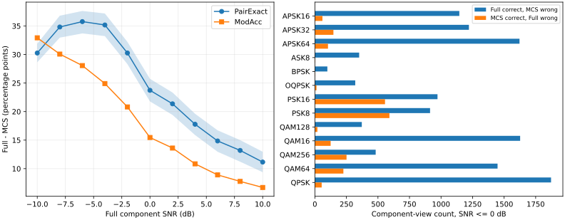

# GATE-2：双信号低 SNR 下 MCS 额外调制混淆定位

日期：2026-11-02（北京时间）。证据等级：**冻结单训练 seed 271060 的 Development 诊断**。本轮只分析既有预测、原始身份/标签、冻结 checkpoint 与 276 对历史 Coset 几何；未训练、未生成信号、未改变物理协议、未读取 Final Test。

## 1. 数据与配对门禁：PASS

沿用[正式配对基线报告](../../20261101_shell_paired_baseline/results/双信号SHELL_Full_MCS严格配对单种子Development报告_20261102.md)的 `Res1dNet31(16,26)` MCS 和 `Res1dNet31(80,26)` Full。服务器任务目录为 `/home/zh_3220241128/SN/SHELL_original_multi_snr_20261029/runs/shell_dual_paired_16900_seed271060_20261101`。MCS/Full 最佳 checkpoint 分别由 Validation 第 188/160 epoch 选出，SHA-256 分别为 `a7c48d53b65f7aa94ee7d46f7822dc4c16153984b8021b4dbbcb742ad0b2d16b` / `c75ed41f68600b860a1d8e314bbd6f8b55b749124a9d0b5220647e0b4d352b1a`。训练配置均为 seed 271060、200 epoch、batch512 和 Validation 逐路 ModAcc 选点。

Full/MCS Development 预测文件 SHA-256 分别为 `d062ef9abd206841d623d0a8e56d09a92b30093775695381ec16284c9baa5691` / `ac7d5e647a64b6b5f5b5d01d5262136ceb490644d1a48041aa2400479e749814`。两臂 37180 行逐行核对 source_uid、view_uid、noise_seed、Full component SNR、两真实 slot 和频率升序真标签完全一致；每档恰 3380 个源，每源恰 11 档。对冻结 Development H5 的 source_uid、view_uid、noise_seed、slot 和调制标签另行核对全部匹配；manifest 中的 3380 个源、11 档视图也全部匹配。逐行正确标记由真/预测标签重新计算，无不一致。校准几何表中历史 Coset 的 276 个 slot 对均可一对一关联；其 `|rho|` 最大 0.58044、`eta` 最大 1.50809。服务器冻结 `coset_preflight.json` 的历史 Coset 顺序和最大相干度分别为 `[16,11,1,0,27,24,37,31]` 与 0.58044，与几何表一致。

分析脚本为[analyze_gate2.py](../code/analyze_gate2.py)，输入哈希和门禁见[质量门禁.json](质量门禁.json)。所有 CSV 由该脚本确定性生成，百分比在下文四舍五入。`D_plus=1(Full PairExact 正确且 MCS 错误)`，`D_minus=1(Full 错误且 MCS 正确)`；配对净差为 `E[D_plus-D_minus]`。逐路 ModAcc 的净差以两个频率升序输出位置的正确率均值计算。区间按 3380 个 source_uid 整簇重采样 2000 次，同一源的 11 档始终一起进入重采样。

## 2. 每档 SNR 的四格配对结果

每行四格之和为 3380。`差` 是 Full−MCS，单位百分点；逐档完整区间见[逐SNR配对四格与源级区间.csv](逐SNR配对四格与源级区间.csv)，逐档两臂 Macro-F1 见[逐SNR_MacroF1.csv](逐SNR_MacroF1.csv)。

|SNR dB|均正确|D+|D−|均错误|Full/MCS PairExact|Pair 净差|Full/MCS ModAcc|Mod 净差|
|---:|---:|---:|---:|---:|---:|---:|---:|---:|
|−10|172|1089|66|2053|37.31% / 7.04%|30.27|61.52% / 28.59%|32.93|
|−8|385|1302|125|1568|49.91% / 15.09%|34.82|70.41% / 40.34%|30.07|
|−6|572|1382|173|1253|57.81% / 22.04%|35.77|76.08% / 48.02%|28.06|
|−4|772|1374|185|1049|63.49% / 28.31%|35.18|79.64% / 54.73%|24.91|
|−2|1015|1229|206|930|66.39% / 36.12%|30.27|81.57% / 60.75%|20.81|
|0|1192|1076|274|838|67.10% / 43.37%|23.73|81.98% / 66.52%|15.46|
|2|1334|1003|281|762|69.14% / 47.78%|21.36|83.28% / 69.67%|13.61|
|4|1467|882|281|750|69.50% / 51.72%|17.78|83.40% / 72.56%|10.84|
|6|1533|805|303|739|69.17% / 54.32%|14.85|83.31% / 74.41%|8.91|
|8|1577|767|321|715|69.35% / 56.15%|13.20|83.28% / 75.52%|7.77|
|10|1638|710|333|699|69.47% / 58.31%|11.15|83.54% / 76.83%|6.70|

全 11 档 D+=11619、D−=2548，Pair 净差 **24.40 pp**，源级 95% bootstrap 区间 **[23.17,25.60] pp**；逐路差 **18.19 [17.45,18.95] pp**。低 SNR（−10 至 0 dB）D+=7452、D−=1029，Pair 净差 **31.67 [30.48,32.88] pp**，逐路差 **25.37 [24.59,26.21] pp**。2 至 10 dB 的 Pair 净差仍为 **15.67 [14.07,17.21] pp**。这些 D+/D− 是配对视图计数，区间的抽样单位仍是 3380 个源。[低高SNR源级配对区间.csv](低高SNR源级配对区间.csv)保留原始数值。

## 3. 调制类别与真实混淆方向

完整 11 档 × 两臂 × 13 类的 Recall、Precision、F1 见[逐SNR逐类指标.csv](逐SNR逐类Recall_Precision_F1.csv)，完整 13×13 混淆矩阵见[长表.csv](完整13x13混淆矩阵长表.csv)。[总体低高SNR逐类指标.csv](总体低高SNR逐类指标.csv)汇总 all/low/high；[逐SNR逐类配对错误四格.csv](逐SNR逐类配对错误四格.csv)分解每类逐路 D+/D−/共同错误；[逐SNR_Pair四格内逐类错误.csv](逐SNR_Pair四格内逐类错误.csv)严格限制在整对 D+、D−或共同错误的样本。混淆方向全计数见[重点混淆方向全类长表.csv](重点混淆方向全类长表.csv)。

|真类别|MCS/Full 总体 Recall|MCS/Full 低 SNR Recall|MCS/Full 高 SNR Recall|逐路净差 pp|两臂共同错误占该类|
|---|---:|---:|---:|---:|---:|
|QPSK|44.1% / 96.8%|36.3% / 94.6%|53.5% / 99.5%|52.7|2.2%|
|QAM16|41.0% / 79.2%|18.7% / 66.9%|67.8% / 94.1%|38.2|16.9%|
|QAM64|37.0% / 70.1%|22.6% / 61.8%|54.3% / 80.0%|33.0|21.7%|
|APSK64|57.3% / 89.2%|33.0% / 81.7%|86.4% / 98.3%|31.9|8.3%|
|PSK16|45.7% / 54.9%|39.6% / 52.9%|53.1% / 57.4%|9.2|24.2%|
|PSK8|36.9% / 42.1%|33.0% / 43.4%|41.6% / 40.6%|5.2|35.6%|
|QAM256|13.3% / 18.3%|10.8% / 18.2%|16.4% / 18.3%|4.9|71.8%|

**主要额外混淆是 QPSK→PSK16/PSK8。**5720 次 QPSK 分量视图中，MCS 判为 PSK16 **1896** 次、PSK8 **950** 次、OQPSK **139** 次；Full 相应为 109、40、28 次。QPSK 的逐路 Full 正确/MCS 错误为 3075，反向仅 60；低 SNR 仍有 1872 对 54，高 SNR 仍有 1203 对 6。MCS QPSK Recall 从 −10 dB 的 32.9% 到 +10 dB 仅 55.2%，Full 从 80.4% 到 99.4%。因此 **OQPSK 不是 QPSK 的主要错分去向**。目前只能确认冻结网络在稀疏观测下对 QPSK 与高阶 PSK 的类别边界特别弱；单凭预测不能判定其根因为采样数、测量几何还是网络训练。MCS 的 QPSK 总体 Precision/Recall/F1 为 0.535/0.441/0.483，Full 为 0.976/0.968/0.972。

QAM16 的 MCS 主要错判 APSK64（1365）、APSK16（600）和 QAM64（464）；QAM64 主要错判 APSK64（961）、QAM16（833）、QAM256（620）。两类差距在低 SNR 最强，但高 SNR 仍存在。PSK8↔PSK16 是两臂共同的分类瓶颈：Full 的 PSK8→PSK16 为 3254、PSK16→PSK8 为 2494；MCS 分别为 2636、2187，不能把该互混全部归咎于 MCS。QAM256 更明显：5720 次中 Full 判成 QAM64 **3989** 次，MCS 判成 QAM64 **2370** 次；两臂共同错 4108 次，占该类 **71.8%**，高 SNR Recall 仍仅为 Full 18.3%、MCS 16.4%。这提示两臂共享类别分辨瓶颈，但现有预测无法确定是星座、有限观测时间、信号混合还是训练偏置中的哪一项。

同类双信号每档 260 源、异类每档 3120 源。全 11 档同类 Full/MCS PairExact 为 **71.08%/47.59%**，异类为 **61.90%/37.42%**；净差分别为 23.50/24.47 pp。逐档见[同类异类逐SNR_PairExact.csv](同类异类逐SNR_PairExact.csv)。两个输出位置总体逐路准确率：Full 位置1/2 为 **78.75%/79.07%**，MCS 为 **62.41%/59.04%**。MCS 位置1−位置2差 3.37 pp，源级区间约 [1.74,4.99] pp；Full 差 −0.33 pp，区间跨 0。逐档见[两个输出位置逐SNR准确率.csv](两个输出位置逐SNR准确率.csv)，区间见[输出位置源级差异区间.csv](输出位置源级差异区间.csv)。位置按频率升序，其差异也可能含 slot 或类别构成效应，不能直接解释为“第二路更弱”。

## 4. 276 对真实子带位置与几何关联

固定历史 Coset `[16,11,1,0,27,24,37,31]`，不比较其他 Coset。事先按物理值划分 `|rho|∈[0,0.2),[0.2,0.4),[0.4,0.6]`，间距划分 1–4、5–8、9–12、13–23 槽。各组源数与逐档、低高 SNR 的 Full/MCS PairExact、D+/D−、逐路和 Pair 净差见[相关性和间距预固定分层.csv](相关性和间距预固定分层.csv)；[逐源配对差与双槽几何.csv](逐源配对差与双槽几何.csv)保留每个源的 slot、两真标签、间距、`|rho|`、`eta` 与净差。276 个对子在 Development 中均出现，但每对子仅 **5–26 个独立源**，所以不做单对子胜负排名。

|范围与相关性层|独立源|Full PairExact|MCS PairExact|D+|D−|净差|
|---|---:|---:|---:|---:|---:|---:|
|低 SNR / [0,0.2)|1441|54.89%|26.64%|2934|491|28.26 pp|
|低 SNR / [0.2,0.4)|1201|59.38%|25.74%|2762|338|33.64 pp|
|低 SNR / [0.4,0.6]|738|57.25%|22.11%|1756|200|35.14 pp|
|高 SNR / [0,0.2)|1441|67.40%|56.47%|1570|783|10.92 pp|
|高 SNR / [0.2,0.4)|1201|70.79%|54.32%|1476|487|16.47 pp|
|高 SNR / [0.4,0.6]|738|70.70%|47.07%|1121|249|23.63 pp|

源内平均 11 档或预定低/高档后，用**169 个频率升序有序调制组合固定效应 + 粗间距区间固定效应**进行源级稳健线性关联分析。`|rho|` 每增加 0.1，Pair 净差的拟合变化：全档 **+2.23 pp**（HC3 95% 区间 [1.52,2.94]）、低 SNR **+1.31 pp**（[0.60,2.02]）、高 SNR **+3.34 pp**（[2.34,4.33]）；逐路结果见[控制调制组合和粗间距后的相关性关联.csv](控制调制组合和粗间距后的相关性关联.csv)。这说明**位置/间距相关的分类差异在不同 SNR 范围仍可观察到**，但不是几何放大对分类损失的因果估计。对固定历史 Coset，`|rho|` 在同一**精确槽间距**内的最大变化仅 `2.8×10⁻¹⁵`；`eta=1/(1−|rho|²)` 也完全由它确定。因此精确间距、`|rho|` 与 `eta` 无法在现有观测数据中独立识别。全档 Full 的 PairExact 在三相关性层为 60.58%、64.57%、63.37%，MCS 为 40.20%、38.73%、33.46%；Full 自身也随位置改变。当前关联在高 SNR 更强，不能简单解释为低 SNR 理想线性分离噪声放大。

## 5. 物理、网络与论文表述边界

**A 观测预算：**MCS 每个 40 点块保留 8 个时间位置，Full 保留 40 个；全体结果支持稀疏观测下存在额外分类困难，但 Full/MCS 首层 80/16 通道也不同，不能把 24.40 pp 的 Pair 差全部量化为纯采样数效应。**B 测量几何：**冻结 276 对解析 `eta` 最大仅 1.508；已有 Oracle 约 6.99 dB 是已知槽、理想线性恢复条件下的噪声处理差。本轮未重新证明它，也不能把该 dB 值换算成 CNN ModAcc 损失。**C 网络/训练：**QPSK 在高 SNR 的 MCS Recall 仍仅约 55%，PSK8/PSK16 和 QAM256 在两臂均难；这与表示及分类边界限制相容，但根因 **UNKNOWN**。模型单 seed 的参数差、训练偶然性也未由源级 bootstrap 覆盖。

**GATE-2 裁决：诊断 PASS，几何因果归因 UNKNOWN。**最主要的额外混淆是 QPSK→PSK16/PSK8，其次 QAM16、QAM64 与 APSK64 相关错分；QAM256 和 PSK8/PSK16 互混主要是共同瓶颈。关联分析足以确定下一阶段应重视真实 slot、调制组合与类别方向，但**尚不足以直接冻结或宣称基于双槽测量矩阵的结构感知新模型具有依据**。唯一最小控制建议是在同一冻结数据和同一历史 Coset 上，用**原有 `Res1dNet31(80,26)` 接收仅保留 8 个 Coset 位置、其余通道固定为零的 Full 输入**，固定同一 seed/训练/选模规则。这一单项未来对照可把 Full80 与稀疏观测的首层通道容量差分开；即使完成，也仍不能单独证明 `eta` 的因果效应。该控制**未获本轮训练授权，未启动**，更不构成 Coset 搜索或新架构方案。

## 6. 证据留存、磁盘与单 seed 写作

服务器当前可用 RAM 约 **112 GiB**，四卡各约 **48.7 GiB** 显存空闲；磁盘余量 **154 GiB**。服务器紧凑 v2 配对 H5 与 manifest 共约 **24 GiB**，可重建的 Full noisy 缓存约 **80 GiB**，两个 checkpoint/日志/预测各约 29 MiB。**内存不是当前瓶颈**：删磁盘文件并不会直接增加可用 RAM，Linux 文件缓存可按需回收。现在不删除紧凑原始 H5、manifest、冻结代码/配置、checkpoint、history、预测或本轮分析输出。80 GiB Full 缓存属于可再生中间件，若将来磁盘紧张，可在复核重建脚本、hash 与 P0 记录并确定没有未结束作业后单独清理；本轮没有清理需求，也未执行删除。

本地保留原预测、Development manifest、276 对几何表、完整逐视图配对表、逐源表及上述 CSV/图；服务器保留原件。论文可以报告这组**单 seed Development** 数值、完整协议和源级区间，但必须写明它不覆盖训练初始化不确定性，也不能称为跨 seed 稳健性或最终无偏结论。若作为论文核心方法优越性论证，仍需以后在方案冻结后完成独立最终评价与训练 seed 稳健性验证；本轮禁止的 Final Test 和额外训练均未使用。

