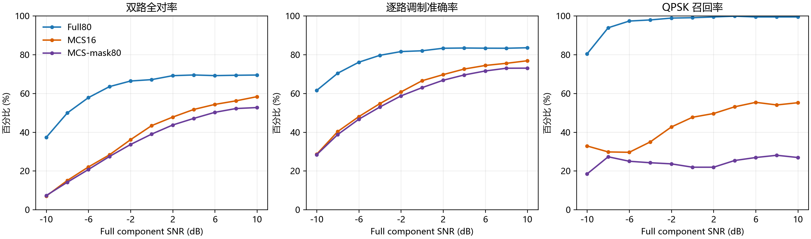

# GATE-3A：同架构稀疏观测控制与研究裁决

日期：2026-11-03（北京时间）。证据级别：**单训练 seed 的 Development 结果**。研究目标为低信噪比下多陪集采样双信号调制识别。本轮只新增 `Res1dNet31(80,26)` MCS-mask80；Full80、MCS16 使用已冻结权重，不重新训练，不读取 Final Test。

## 1. 合同、训练与质量门禁

三个模型分别为 Full80、原生 MCS16、MCS-mask80。mask80 保留与 MCS16 **逐点相同**的 8 个 Coset 复观测，只将其放入对应的 80 通道物理时间位置，其余 32 个复位置固定为零；输入幅值统一为物理 IQ/8。mask80 与 Full80 均有 **6,324,122 个参数**，参数张量形状一致。冻结 v2 训练/Validation/Development 各为 16900/3380/3380 个独立源，每源 11 档 SNR，同源、同噪声和同标签。mask80 的训练协议为 seed 271060、200 epoch、batch512、原 SHELL BCEWithLogits 与 0.026 平滑、Adam `lr=0.001` 和 `weight_decay=0.0001`、5 epoch warmup 后 cosine；仅按 Validation 逐路 ModAcc 选点。训练前 P0 证据见[门禁记录](GATE3A训练前门禁与启动记录_20261102.md)。

mask80 训练日志恰有 200 个 epoch。最高 Validation 逐路 ModAcc 为 **58.78%**，出现在 **epoch 159**，与 `best_validation.json` 一致；该轮训练损失 0.09752、Validation 损失 0.13854、Validation PairExact 36.29%、Macro-F1 0.5733。用所选 checkpoint 评价 Development：损失 0.13937、逐路 ModAcc **58.39%**、PairExact **35.29%**、Macro-F1 **0.5686**。checkpoint SHA-256 `075826f4ffedf1d14c0709a08fef47afc962b1324fa9076d79334f1e198bb493`；mask80 逐视图预测 SHA-256 `6f9d0ccbf371b81992c0a790ec6c69778058cbe5c027219a07ae5b39b19f4163`。历史 Full80 实际初始权重未保存，故不能声称两臂实际初值逐张量相同；mask80 自身初始化可确定性复现。

三套 Development 预测逐行通过 `source_uid`、`view_uid`、`noise_seed`、SNR、两真实 slot 和两路真标签核对：各 **37180** 视图、**3380** 独立源、每档 **3380** 源，正确性列由预测重新计算并一致。Full80、MCS16 原预测 SHA-256 分别为 `d062ef9abd206841d623d0a8e56d09a92b30093775695381ec16284c9baa5691`、`ac7d5e647a64b6b5f5b5d01d5262136ceb490644d1a48041aa2400479e749814`。**训练与评价质量门禁：PASS。**

## 2. 三模型逐 SNR Development 结果

每行均为相同的 3380 个独立源；同一源跨 SNR 的视图不作独立源。准确率为百分比，Macro-F1 为 0–1。

|SNR dB|Full80 逐路|MCS16 逐路|mask80 逐路|Full80 PairExact|MCS16 PairExact|mask80 PairExact|Full80 F1|MCS16 F1|mask80 F1|
|---:|---:|---:|---:|---:|---:|---:|---:|---:|---:|
|−10|61.52|28.59|28.36|37.31|7.04|7.31|0.6113|0.2648|0.2628|
|−8|70.41|40.34|38.77|49.91|15.09|14.17|0.7009|0.3892|0.3699|
|−6|76.08|48.02|46.67|57.81|22.04|20.74|0.7551|0.4718|0.4548|
|−4|79.64|54.73|52.97|63.49|28.31|27.46|0.7896|0.5402|0.5181|
|−2|81.57|60.75|58.71|66.39|36.12|33.64|0.8074|0.5989|0.5728|
|0|81.98|66.52|62.96|67.10|43.37|38.99|0.8107|0.6583|0.6147|
|2|83.28|69.67|66.78|69.14|47.78|43.70|0.8229|0.6902|0.6525|
|4|83.40|72.56|69.51|69.50|51.72|47.10|0.8240|0.7191|0.6798|
|6|83.31|74.41|71.57|69.17|54.32|50.24|0.8226|0.7370|0.6990|
|8|83.28|75.52|72.97|69.35|56.15|52.19|0.8223|0.7469|0.7120|
|10|83.54|76.83|73.02|69.47|58.31|52.69|0.8250|0.7600|0.7132|

全部 11 档合并后，Full80/MCS16/mask80 的逐路 ModAcc 分别为 **78.91%/60.72%/58.39%**，PairExact 为 **62.60%/38.21%/35.29%**，Macro-F1 为 **0.7815/0.5982/0.5686**。

## 3. 严格配对净差及区间

下表差值按前者减后者。每次 bootstrap 抽取 **3380 个 source_uid**，将该源相应 SNR 视图整体保留；2000 次重采样报告 95% 百分位区间。PairExact 净差等于 `D_plus−D_minus` 的源级均值，绝非只计单方向错误。

|比较|SNR 范围|PairExact 净差及 95% 区间（百分点）|逐路 ModAcc 净差及 95% 区间（百分点）|
|---|---|---:|---:|
|Full80−MCS16|−10 至 0|31.67 [30.48, 32.88]|25.37 [24.59, 26.21]|
|Full80−mask80|−10 至 0|**33.28 [32.10, 34.45]**|**27.13 [26.31, 27.91]**|
|MCS16−mask80|−10 至 0|1.61 [0.89, 2.33]|1.75 [1.19, 2.29]|
|Full80−MCS16|全部 11 档|24.40 [23.17, 25.60]|18.19 [17.45, 18.95]|
|Full80−mask80|全部 11 档|27.31 [26.13, 28.52]|20.52 [19.82, 21.24]|
|MCS16−mask80|全部 11 档|2.91 [2.05, 3.73]|2.33 [1.79, 2.86]|

各档四格计数及其成组区间在 `三组比较逐SNR配对四格.csv` 中。以 Full80−mask80 的 −10 dB 为例，`D_plus=1087`、`D_minus=73`，净差 **30.00** 个百分点；−6 dB 则为 1419、166，净差 **37.07** 个百分点。原 MCS16 与 mask80 的差异在高 SNR（2 至 10 dB）增至 PairExact **4.47** 个百分点，提示输入表示、网络容量或其优化相互作用不能忽略。

## 4. 类别与混淆方向

所有 SNR 合并的类别召回率如下；完整逐 SNR 的 13 类 Recall、Precision、F1 与 13×13 混淆矩阵均留存 CSV。

|类别|Full80 Recall|MCS16 Recall|mask80 Recall|
|---|---:|---:|---:|
|QPSK|96.80%|44.09%|**24.53%**|
|QAM16|79.25%|41.03%|36.38%|
|QAM64|70.05%|37.01%|35.38%|
|QAM256|18.25%|13.34%|16.99%|
|PSK8|42.12%|36.94%|17.50%|
|PSK16|54.95%|45.72%|60.61%|

低 SNR（−10 至 0 dB）QPSK 的 Full80/MCS16/mask80 Recall 为 **94.55%/36.28%/23.43%**。QPSK→PSK16 的视图计数为 **99/970/1198**，QPSK→PSK8 为 **37/666/665**。mask80 在全部 11 档中 QPSK→PSK16 共 **2533/5720**，QPSK→PSK8 **1256/5720**；在 2 至 10 dB 仍分别有 **1335/2600**、**591/2600**。QPSK 额外混淆并未因扩大到与 Full 相同的 80 通道网络而消失，反而更突出。mask80 的 PSK8→PSK16 达 **3470/5720**，PSK8 Recall 仅 17.50%，属于本控制模型值得警惕的类别偏置；完整 13 类均有非零预测，故不是某类从输出中完全消失。

低 SNR QAM16 的 Full80/MCS16/mask80 Recall 为 **66.86%/18.72%/15.64%**，QAM64 为 **61.76%/22.60%/20.54%**。mask80 全档 QAM16→APSK64 **1491/5720**，QAM64→APSK64 **999/5720**；原 MCS16 相应为 1365、961。两种稀疏观测表示均保留明显额外混淆。QAM256 在 Full80/MCS16/mask80 的整体 Recall 均低（18.25%/13.34%/16.99%），Full80 的 QAM256→QAM64 达 **3989/5720**；这一项主要是两臂共同分类瓶颈，不能归为 MCS 特有困难。PSK8/PSK16 互混也在 Full80 存在。

## 5. GATE-3A 裁决

**A. 同为 80 通道时低 SNR 差异仍明显：PASS。** Full80−mask80 的低 SNR PairExact 净差 33.28 [32.10, 34.45] 个百分点，逐路净差 27.13 [26.31, 27.91] 个百分点。首层参数量差异不足以解释原 Full80−MCS16 的大部分差距。

**B. QPSK 额外混淆仍存在：PASS。** mask80 对 QPSK→PSK16/PSK8 的混淆比 MCS16 更重，且延续到高 SNR。

**C. MCS16 与 mask80 的差异提示表示或优化因素重要：PASS（观察），具体归因 UNKNOWN。** 两者输入观测点相同，mask80 的总 PairExact 低 2.91 个百分点、QPSK Recall 低 19.56 个百分点。它们同时改变输入布局与参数规模，且仅有一个训练 seed，不能只归因于零填充布局、容量或优化中的某一项。

**D. 支持的研究假设：**相同 Res1dNet31 主干和 80 通道容量下，稀疏观测仍在 QPSK 的相近 PSK 阶数、QAM16/64 的判别上表现出额外困难；这是设计物理关系显式编码方法的开发依据。现有结果仍混合了观测预算减少、测量几何、网络特征提取和单 seed 优化效应，不能作单一机制因果结论。

**E. 可以进入 GATE-3B 的方法设计阶段：YES；不自动启动实验。** 唯一值得预注册验证的假设是：**利用冻结 Coset 采样时刻和测量矩阵进行固定、无可训练参数的相位关系编码，在保持同一 MCS 观测、80 通道 Res1dNet31 容量与训练协议时，能减少 QPSK→PSK16/PSK8 混淆。**必要消融仅为现有 mask80 零填充基线；不得使用真实 slot，须先明确数学变换与输入数值尺度，禁止借 Development 选择多个编码版本。当前只是候选，不授权启动训练。

**F. 若要求进一步隔离输入布局与优化本身，当前仍缺跨 seed 稳定性控制。**在用户另行批准前不增加 seed 或模型。本轮结论严格标注 Development，不称最终论文显著性结论。

## 6. 留存与资源

服务器保留 mask80 最佳 checkpoint、200 轮 history、Validation/Development 摘要、Development 逐视图预测；本地保留预测原件及 SHA-256、三个模型的逐 SNR 指标、逐类表、完整混淆矩阵、配对四格/成组区间、类别预测覆盖表和图。三份可重建的 Full noisy 缓存已清理，原始紧凑 v2 数据与历史结果未删。完成后检查四卡空闲、可用 RAM 115 GiB、磁盘可用 233 GiB。本轮未启动其他训练或数据生成，也未读取 Final Test。
