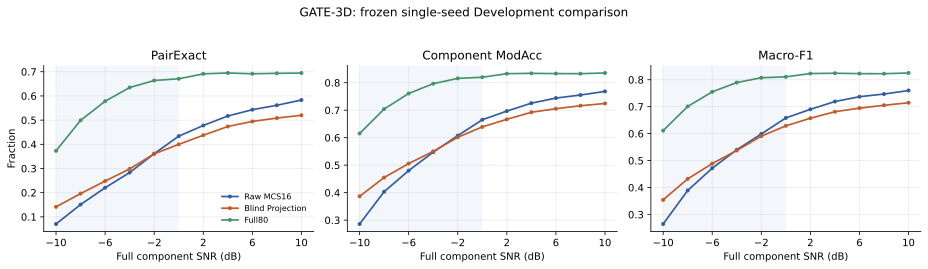

# GATE-3D：Blind Projection + SHELL16 单种子分类验证报告

日期：2026-11-04（北京时间）。研究阶段：**Development，单训练 seed 271060**。本报告只比较冻结的 Raw MCS16、Blind Projection + SHELL16 和 Full80；Final Test 未读取。

## 1. 裁决

**PARTIAL，不晋升为已解决低 SNR 额外混淆的论文方法。** 相同 8 路 MCS 观测下，Blind Projection 相对 Raw MCS16 在 −10～0 dB 的 PairExact 从 **25.330%** 升至 **27.406%**（+2.076 个百分点，源级成组 95% Bootstrap 区间 +1.223～+2.929），逐路 ModAcc 从 **49.827%** 升至 **52.310%**，Macro-F1 从 **0.4871** 升至 **0.5051**。但 +2～+10 dB 的 PairExact 从 **53.657%** 降至 **48.692%**（−4.965 个百分点，区间 −6.426～−3.497），PSK8 等重点类别明显退化；全 11 档平均 PairExact 反而降低 1.124 个百分点。因此物理域有效 SNR 增益没有一致转化成调制分类收益，不能宣布该方法有效解决 QPSK→高阶 PSK 的额外混淆。

这是由一项预先冻结的处理链和一个训练 seed 得到的开发结果。源级 Bootstrap 反映固定模型在独立源上的配对不确定性，**不替代跨训练 seed 验证**。本轮按合同停止，不调整 SOMP、投影、模型或训练参数。

## 2. 数据、模型与门禁

- 冻结 v2 同源数据：Train 16900、Validation 3380、Development 3380 个独立源，每源 11 档 Full component SNR（−10:2:+10 dB）；真实双信号频率升序。三臂共源、共噪声、共标签。
- 候选路径：原始 8 路 MCS IQ → 冻结两轮盲 SOMP → 预测双槽测量子空间的 QR 正交投影 → 1024 点正交 IFFT → 16 通道物理 IQ/8 → 随机初始化 Res1dNet31(16,26)。支持估计和投影均无可训练参数；真实 slot、SNR、调制标签和 Full 独有观测不参与候选输入。
- 训练：200 epoch、batch512、原 SHELL BCEWithLogits 和 0.026 平滑、Adam `lr=0.001`、`weight_decay=0.0001`、5 epoch warmup 后 cosine；仅 Validation 逐路 ModAcc 选模。未重训 Raw MCS16 或 Full80。
- 正式 H5 batch512 前后向、有限值、梯度、投影数值、缓存身份和资源门禁均 PASS；GPU 峰值已分配 5.2283 GiB、保留 5.4316 GiB。详见[训练前门禁与启动记录](GATE3D_BlindProjection_训练前门禁与启动记录_20261103.md)。服务器进程 PID 4025246 完成后退出，未见 OOM 或异常。
- `history.csv` 为连续 1～200 epoch 共 200 行，`development_predictions.csv` 为 37180 行。三臂逐行核对 `source_uid`、`view_uid`、`noise_seed`、SNR、真实双槽及两路调制标签完全一致；每档 3380 个唯一源，同一源的 11 个视图归为一个 Bootstrap 簇。预测正确性标志与真实/预测标签重新计算一致。GATE-3C 支持估计表的源、视图、噪声和真实槽亦逐行一致；支持准确性按**无序双槽集合**核对，避免把 SOMP 的选出顺序误判为错误。

## 3. Validation 选点及总体结果

| 模型 | 最佳 Validation epoch | 最佳轮训练损失 | 最佳轮 Validation 损失 | Validation ModAcc | Validation PairExact | Validation Macro-F1 | Development ModAcc | Development PairExact | Development Macro-F1 |
|---|---:|---:|---:|---:|---:|---:|---:|---:|---:|
| Raw MCS16 | 188 | 0.08854 | 0.13562 | 60.73% | 38.47% | 0.5983 | 60.72% | 38.21% | 0.5982 |
| Blind Projection | **65** | **0.09550** | **0.12987** | **61.17%** | **38.28%** | **0.6002** | **60.40%** | **37.08%** | **0.5907** |
| Full80 | 160 | 见冻结 GATE-1 报告 | 见冻结 GATE-1 报告 | 79.18% | 见冻结 GATE-1 报告 | 见冻结 GATE-1 报告 | 78.91% | 62.60% | 0.7815 |

Blind 的 200 行 Validation ModAcc 最大值恰在 epoch 65，等于 `best_validation.json`；该轮 Validation 损失也与历史行一致。`development.json` 的三项指标由逐视图预测重算一致。最佳 checkpoint 是模型权重张量，SHA-256 为 `b21081ac2d3696ed96cf495a4b28e058622d792ac53e086f6efa571a534fb004`。第 200 轮训练/Validation 损失分别为 **0.03726/0.18213**，Validation ModAcc **59.65%**，与最佳轮相比验证损失上升，存在明显泛化差距；仍严格采用 epoch 65 权重，不使用 Development 改选点。

## 4. 全 11 档 SNR 性能

每格按 **Raw / Blind / Full** 排列。完整数值、13 类逐 SNR 指标与 13×13 混淆矩阵分别见[三模型逐SNR指标](三模型逐SNR指标.csv)、[逐类指标](三模型逐SNR逐类指标.csv)、[完整混淆矩阵](三模型完整13x13混淆矩阵.csv)。

| SNR dB | PairExact % | 逐路 ModAcc % | Macro-F1 |
|---:|---:|---:|---:|
| −10 | 7.04 / 14.14 / 37.31 | 28.59 / 38.67 / 61.52 | .2648 / .3544 / .6113 |
| −8 | 15.09 / 19.62 / 49.91 | 40.34 / 45.50 / 70.41 | .3892 / .4322 / .7009 |
| −6 | 22.04 / 24.79 / 57.81 | 48.02 / 50.59 / 76.08 | .4718 / .4889 / .7551 |
| −4 | 28.31 / 29.85 / 63.49 | 54.73 / 55.01 / 79.64 | .5402 / .5376 / .7896 |
| −2 | 36.12 / 36.07 / 66.39 | 60.75 / 60.16 / 81.57 | .5989 / .5907 / .8074 |
| 0 | 43.37 / 39.97 / 67.10 | 66.52 / 63.92 / 81.98 | .6583 / .6290 / .8107 |
| +2 | 47.78 / 43.76 / 69.14 | 69.67 / 66.69 / 83.28 | .6902 / .6573 / .8229 |
| +4 | 51.72 / 47.37 / 69.50 | 72.56 / 69.25 / 83.40 | .7191 / .6812 / .8240 |
| +6 | 54.32 / 49.47 / 69.17 | 74.41 / 70.53 / 83.31 | .7370 / .6946 / .8226 |
| +8 | 56.15 / 50.86 / 69.35 | 75.52 / 71.63 / 83.28 | .7469 / .7051 / .8223 |
| +10 | 58.31 / 52.01 / 69.47 | 76.83 / 72.44 / 83.54 | .7600 / .7145 / .8250 |

在 −10、−8、−6 dB，Blind 的 PairExact 配对净增分别为 **7.10、4.53、2.75** 个百分点；−4 dB 增幅 1.54 个百分点但源级区间跨零，−2 dB 近似持平；自 0 dB 起每档 PairExact 均下降，+10 dB 降幅 **6.30** 个百分点。Full80 在所有档位仍明显领先，Blind 投影不恢复 Full 观测预算。

## 5. 源级严格配对

定义 `D_plus=1(Blind PairExact、Raw 非 PairExact)`，`D_minus=1(Blind 非 PairExact、Raw PairExact)`；净差为 `E[D_plus-D_minus]`。逐档四格及反向样本见[配对四格](Raw_Blind逐SNR配对四格.csv)，2000 次源级成组 Bootstrap 见[区间表](源级成组Bootstrap区间.csv)。

| 范围 | 双方正确 | D_plus | D_minus | 双方错误 | PairExact 净差 | 95% 源级区间 | ModAcc 净差 |
|---|---:|---:|---:|---:|---:|---:|---:|
| −10～0 dB，20280 源视图 | 2994 | 2564 | 2143 | 12579 | +2.076 pp | +1.223～+2.929 pp | +2.483 pp |
| +2～+10 dB，16900 源视图 | 5917 | 2312 | 3151 | 5520 | −4.965 pp | −6.426～−3.497 pp | −3.692 pp |
| 全部 11 档，37180 源视图 | 8911 | 4876 | 5294 | 18099 | −1.124 pp | −2.122～−0.129 pp | −0.324 pp |

表中 20280/16900/37180 是视图数，**独立源始终只有 3380 个**；统计区间先在每源内部汇总所选 SNR，再抽样源。仅报告 `D_plus` 会掩盖高 SNR 反向样本更多这一事实。

## 6. 13 类判别与预注册混淆方向

下表为低 SNR（−10～0 dB）逐路 Recall，全部类的 Precision、F1、预测频数以及高 SNR 对照见[低高SNR逐类汇总](三模型低高SNR逐类汇总.csv)。每类低 SNR 真值支持数均为 3120 个分量视图。

| 类别 | Raw Recall % | Blind Recall % | Full Recall % | Blind−Raw pp |
|---|---:|---:|---:|---:|
| APSK16 | 52.1 | 50.3 | 86.9 | −1.8 |
| APSK32 | 39.4 | 32.9 | 73.8 | −6.5 |
| APSK64 | 33.0 | 43.6 | 81.7 | +10.6 |
| ASK8 | 88.7 | 95.6 | 99.8 | +7.0 |
| BPSK | 96.8 | 98.5 | 99.9 | +1.7 |
| OQPSK | 89.4 | 97.1 | 99.3 | +7.7 |
| PSK16 | 39.6 | 57.9 | 52.9 | +18.4 |
| PSK8 | 33.0 | **16.8** | 43.4 | **−16.2** |
| QAM128 | 87.3 | 93.8 | 98.6 | +6.4 |
| QAM16 | 18.7 | **14.1** | 66.9 | −4.6 |
| QAM256 | 10.8 | **8.6** | 18.2 | −2.2 |
| QAM64 | 22.6 | 31.9 | 61.8 | +9.3 |
| QPSK | 36.3 | 38.7 | 94.6 | +2.4 |

预注册方向的低 SNR 错误次数（Raw → Blind）：`QPSK→PSK16` **970→1184**，`QPSK→PSK8` **666→516**，两者合计 **1636→1700**，故不能宣称 QPSK 对 PSK8/16 的合并额外混淆被消除。`PSK8→PSK16` **1213→1873**，`PSK16→PSK8` **1049→534**；PSK16 Recall 的提高伴随 PSK8 大幅转向 PSK16。`QAM16→APSK64` **797→1074**，`QAM64→APSK64` **562→844**，`QAM256→QAM64` **779→1098**，均恶化。完整逐 SNR 次数见[重点方向表](重点类别混淆方向.csv)。

高 SNR PSK8 Recall **41.6%→16.1%**（−25.5 pp），QAM16 **67.8%→49.7%**（−18.2 pp），APSK64 **86.4%→72.5%**（−13.9 pp），APSK32 **88.6%→77.7%**（−10.9 pp）。PSK8 的高 SNR 预测频数从 Raw 的 2504 降至 Blind 的 1281（每类高 SNR 真值 2600），低 SNR 预测频数从 3293 降至 1857（真值 3120）。这不是仅少量随机波动，而是明显类别偏向；PSK8 仍有非零预测，故本报告采用合同中的 **PARTIAL** 分支，不把它表述为全类完全塌缩。

## 7. 盲支持错误传播

GATE-3C 冻结支持估计在 Development 共 **51/37180** 个视图错误，全部位于 **−10 dB**；该档为 **51/3380 = 1.51%**。这 51 个视图的真实双槽间距均为 12；−10 dB 同间距样本共 149 个，其中 51 个支持错误。该集中现象是固定测量结构下的观察，不能仅凭本轮分类结果作独立因果归因。每个错误视图的调制组合、真实/预测槽与三臂结果见[支持错误逐源视图](支持估计错误逐源视图.csv)。

在 −10 dB，支持正确的 3329 个视图上 Blind PairExact **14.33%**、逐路 ModAcc **38.93%**；支持错误的 51 个视图上分别为 **1.96%**、**21.57%**。这 51 个视图 Raw PairExact **5.88%**、Full PairExact **56.86%**；Blind 相对 Raw 有 0 个独有正确、2 个独有错误。条件分组的调制和子带分布不同，不把组间差值解释为支持错误的纯因果效应。尤其在 +2～+10 dB 没有支持估计错误，但分类仍显著退化，说明高 SNR 损失**不能归因于错误支持传播**；固定投影对特征保留、类别边界和训练适配的各自作用尚不能隔离。完整分组指标见[条件分类表](支持正确错误条件分类指标.csv)。

## 8. 研究解释与边界

结果支持一个有限结论：在当前冻结 SOMP、投影、SHELL16 与训练协议下，**盲投影表示有助于极低 SNR 的双信号分类，但代价是中高 SNR 和部分重点类别退化**。GATE-3C 测得的有效 SNR 增益是物理观测指标，不等于 CNN 的调制判别增益；本轮实测恰显示两者不能直接等同。最初关心的 QPSK→PSK16/PSK8 总混淆没有下降，PSK8→PSK16 还明显加重。

本实验不能单独分离采样预算、理想子空间去噪、投影导致的调制特征损失、训练随机性或网络特征提取限制；不能据此宣称盲支持估计具有普适分类收益，也不能宣称 SOMP/QR 为原创算法。此次只使用一个训练 seed 和 Development，不构成最终论文的跨 seed 显著性或 Final Test 结论。按预注册 **PARTIAL** 裁决保存完整结果，当前路线不自动调整或扩展。

## 9. 可复核文件与完整性

服务器原始目录：`/home/zh_3220241128/SN/SHELL_original_multi_snr_20261029/runs/gate3d_blind_projection_20261103/train_blind_seed271060`。本地保留最佳 checkpoint、配置、200 轮 `history.csv`、`best_validation.json`、`development.json`、37180 行逐视图预测以及本报告各 CSV。关键 SHA-256：checkpoint `b21081ac2d3696ed96cf495a4b28e058622d792ac53e086f6efa571a534fb004`；逐视图预测 `4c6d1c7dffd940bea1bd47936c19caa67b77216fae9264d1fa8e1c9f7aa4f0cc`；训练历史 `0ac44999cc5c17602b0fe1e0dc61efc95c1d34020994307d44d0bdfd42b92669`。逐源配对预测见[完整配对表](Raw_Blind_Full逐源配对预测.csv)，审计摘要见[GATE3D 审计摘要](GATE3D_审计摘要.json)。

复核脚本为 [`analyze_gate3d.py`](../code/analyze_gate3d.py)；脚本从冻结预测重算正确标志、指标、配对四格、2000 次源级 Bootstrap、13 类混淆和支持错误条件指标。未读取 Final Test，也未启动第二项训练。

